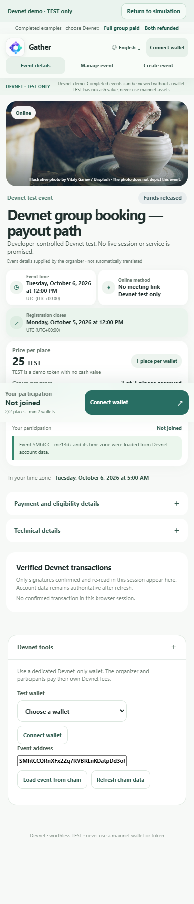
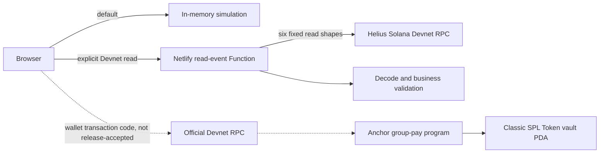

# Gather


**Conditional group-booking payments on Solana Devnet.**

Gather lets an organizer define a fixed-price activity, a minimum number of distinct participant wallets, a capacity, and a registration deadline. Participant funds enter a program-controlled SPL Token vault. If the group succeeds, the legitimate participation amount can be released to the organizer. If the group fails or the organizer cancels within the rules, each participant claims their own refund.

This repository is the judge-facing source package for the **Colosseum Crypto World's Fair** submission. It is a test-only prototype: `TEST` tokens have no cash value, the deployed program is on Devnet, and payment logic does not guarantee that an organizer will deliver an event or service.



## Live demo

- **App:** https://gather-group-pay-devnet.netlify.app/
- **Completed paid activity:** https://gather-group-pay-devnet.netlify.app/devnet.html?event=SMhtCCQRnXFx2Zq7RVBRLnKDatpDd3oKvvZyome13dz
- **Completed refunded activity:** https://gather-group-pay-devnet.netlify.app/devnet.html?event=4SZ2XvXx4eEyNPQLfFbrQTLtfFVJ4SgoagVrTTWkc87S
- **Pitch video:** https://youtu.be/EQY8cPL4Atk
- **Product demo:** https://youtu.be/E9gwixHDBwU

The site always opens in simulation mode. On either completed-activity link, select **Review Devnet test mode** to load validated on-chain display data. A wallet is not needed for these two read-only examples.

## What is real, simulated, historical, and unverified

| Surface | What it proves | Boundary |
| --- | --- | --- |
| Default simulation | The product flow, state transitions, bilingual UI, responsive layout, and individual-refund UX can be explored without a wallet | All balances, identities and `SIM-*` records are in-memory demo data |
| Two live read-only examples | The production Netlify Function currently reads and validates the fixed `PAID` and `REFUNDED` Devnet accounts | Only the two allowlisted addresses are supported; this is not a general RPC proxy |
| Historical on-chain test | Developer-controlled wallets previously created, joined, settled, cancelled and claimed refunds on Devnet | Historical evidence is not a fresh wallet-transaction acceptance run or independent-user validation |
| Transaction-capable source | The frontend and Anchor program contain create, join, settle, cancel, payout-recovery and refund paths | Real-wallet transactions, new activity creation/readback and signing were not revalidated in the production release window |
| Mainnet | Nothing | No mainnet deployment, asset, customer, audit or production-safety claim |

## Architecture



The browser never receives the private provider key. `read-event` accepts only `GET`, rejects non-allowlisted activity addresses before calling upstream, applies an overall deadline and response-size limits, performs no automatic retry, and returns only decoded display data after validating Program, Mint, Token Program, PDA relationships, token accounts, terminal state and participation records.

The Function is display-only. It cannot sign, simulate or send transactions. Existing wallet transaction paths remain separate and use the official Devnet RPC. See [docs/architecture.md](docs/architecture.md) for the contract state model and trust boundaries.

### Public identities

| Item | Public identifier |
| --- | --- |
| Devnet Program | [`96piBXGNG9Ga8ycf6cpEJCFugjqpCvhuGjQHJc4KvzVe`](https://explorer.solana.com/address/96piBXGNG9Ga8ycf6cpEJCFugjqpCvhuGjQHJc4KvzVe?cluster=devnet) |
| Classic SPL TEST Mint | [`BAKZoZLZakRYowjaee7aXTSvTe4hVEwCybBNMAygp8nV`](https://explorer.solana.com/address/BAKZoZLZakRYowjaee7aXTSvTe4hVEwCybBNMAygp8nV?cluster=devnet) |
| Mint decimals | `6` |
| Token Program | Classic SPL Token |

The committed Devnet IDL is [`src/idl/group_pay.devnet.json`](src/idl/group_pay.devnet.json). The program source is [`contract/programs/group-pay/src/lib.rs`](contract/programs/group-pay/src/lib.rs).

## Repository layout

```text
contract/                  Anchor program, Rust/TypeScript tests, pinned toolchains
netlify/functions/         Fixed-scope read-only display Function
public/                    Frontend assets
src/                       React UI, simulation, chain client, IDLs and recovery logic
tests/                     Offline logic, recovery, Function and browser tests
docs/                      Architecture, verification, demo and attribution notes
netlify.toml               Reviewed production build and Function configuration
.env.example               Empty server-only provider-key template
.env.devnet.example        Public Devnet identifiers only
SOURCE_MANIFEST.sha256     SHA-256 list for the clean submission source package
```

Generated bundles, `node_modules`, contract build artifacts, browser profiles, logs and real environment files are intentionally excluded.

## Run the frontend

Prerequisites:

- Node.js 22.18 or newer (the package was verified with Node.js 26.3.0)
- npm

Install exactly the locked dependencies:

```bash
npm ci
```

Start the wallet-free simulation:

```bash
npm run dev
```

Open http://127.0.0.1:5173/. Refresh resets the in-memory demo.

Build the same eight-file frontend shape used by the reviewed release:

```bash
npm run build
npm run preview
```

Open http://127.0.0.1:4173/. The static preview supports simulation. Live local Function reads additionally require a Netlify-compatible Functions runtime and your own server-side `HELIUS_DEVNET_API_KEY`; use [`.env.example`](.env.example) only as a template, keep the real file ignored, and never expose the value through a `VITE_*` variable. Reviewers can use the hosted demo without any credential.

## Test the application

The normal verification is offline and does not connect a wallet or send a transaction:

```bash
npm run verify
```

It runs the Node logic/recovery/Function tests, compiles the frontend and Function TypeScript, builds the stripped public artifact, and checks its eight-file allowlist.

An additional isolated 390 px browser test uses mocked same-origin Function responses:

```bash
npm run test:browser
```

That command requires Microsoft Edge because this repository uses the already-installed `playwright-core` package and does not download a browser. It does not access Devnet.

## Test the program locally

The contract toolchain is pinned in `contract/Anchor.toml` and `contract/rust-toolchain.toml`:

- Anchor CLI `1.2.0`
- Solana CLI `4.1.2`
- Rust `1.89.0`

From a Linux or WSL shell with those tools available:

```bash
cd contract
bash scripts/verify-phase2b.sh
```

The script installs the contract's locked JavaScript dependencies, builds the localnet program, checks the generated IDL against the committed local IDL, runs Rust unit tests, starts an isolated local validator, generates a disposable temporary local test wallet, and runs the TypeScript integration suite. It neither uses a real wallet nor deploys to Devnet.

## Verified evidence

The current production deploy is `6aba878737e9eba16eeb7393`. Its public-origin acceptance covered the homepage, both fixed activity links, refresh-to-simulation behavior, 390 px and 1280 px layouts, the complete Gather logo, bilingual failure messaging, one explicit retry, server response bounds, and the absence of browser-side private RPC calls. The full evidence boundaries and historical transaction links are in [docs/verification.md](docs/verification.md).

The repository-preparation verification was run from this standalone directory after copying the allowlisted source, rather than relying only on the original workspace. Exact results are recorded in that document.

## Known limits

- This is not a professional security audit.
- A wallet address is not proof of a unique person; one person can control multiple wallets.
- Refunds are individual claims, not automatic transfers.
- The program leaves Event, Participation and Vault accounts open and does not recover their rent.
- Unexpected tokens sent directly to a vault are excluded from legitimate obligations and remain isolated.
- The program has no arbitration, chargeback, insurance or off-chain fulfillment enforcement.
- The public Function supports only the two completed examples and is not an uptime guarantee.
- Current production acceptance does not cover real-wallet signing, transaction sending, new activity reads or mainnet.

## AI assistance disclosure

AI coding agents, including OpenAI Codex, assisted with product-rule analysis, implementation, tests, documentation, debugging and review under human direction. The human operator chose the scope, controlled the historical Devnet test wallets, authorized deployments, and approved every historical wallet signature. AI assistance is disclosed here and is not presented as independent user validation, a security audit, revenue, adoption or authorship by nonexistent contributors.

No synthetic or backdated Git history is included. The repository contains only the actual preparation and follow-up commits.

## License status and attribution

No project license has been selected or added. [LICENSE-CHOICE.md](LICENSE-CHOICE.md) records common options without making a legal choice for the owner.

The interface uses an illustrative photograph by Vitaly Gariev via Unsplash. It does not depict either test activity. See [docs/photo-credit.md](docs/photo-credit.md).
